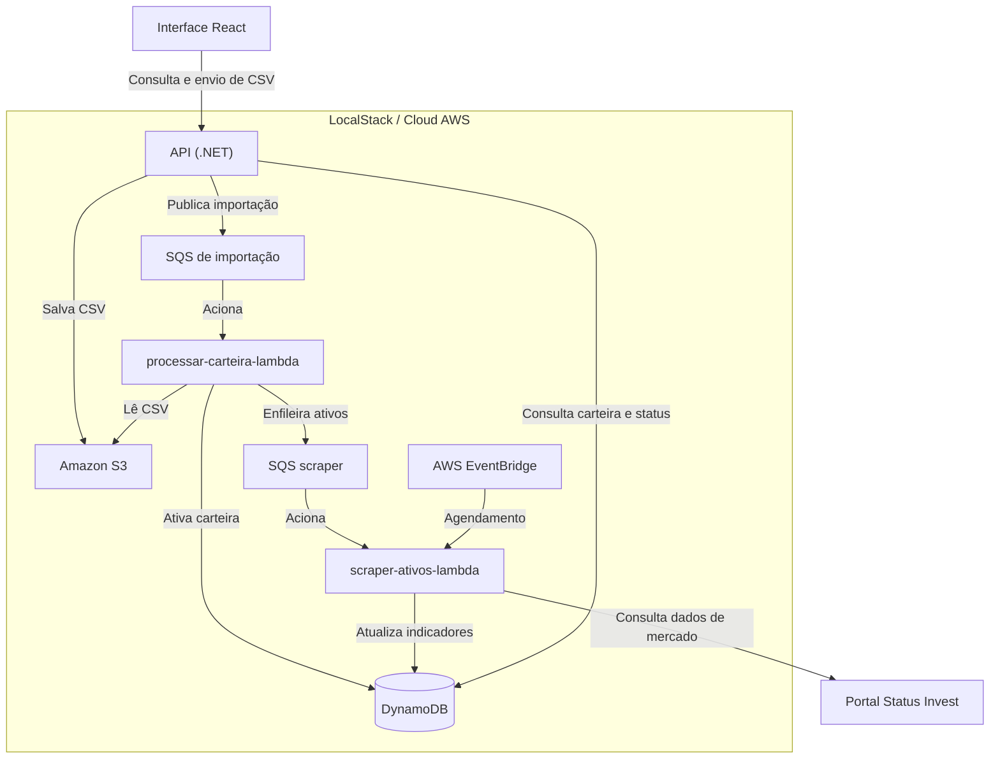

# FII Analytics Engine

## Descrição
O **FII Analytics Engine** é um sistema de engenharia de dados serverless projetado para automação, extração e análise de indicadores financeiros de Fundos de Imobiliários (FIIs). O projeto centraliza a coleta de dados de mercado, processamento e persistência, utilizando uma arquitetura moderna baseada em eventos e escalabilidade em nuvem.

Os testes incluem verificações dos handlers .NET, do repositório DynamoDB e das Lambdas Python.

### Interface


*Captura ilustrativa: carteira, valores e cotações são fictícios. A aplicação consulta a API real e não possui modo de demonstração.*

## 🏗️ Arquitetura do Projeto
O sistema foi desenhado para ser desacoplado e resiliente:

* **Ingestão:** API .NET que persiste arquivos no **S3**.
* **Orquestração:** Infraestrutura como código (**LocalStack**), simulando AWS localmente.
* **Processamento:** Funções Lambda que reagem a eventos em filas (**SQS**).
* **Armazenamento:** Persistência estruturada em **Amazon DynamoDB**.


Na animação, a interface envia o CSV à API; a API o salva no S3 e publica uma mensagem na fila de importação. A Lambda processa o arquivo, enfileira os ativos para o scraper e ativa a nova carteira no DynamoDB. O scraper consulta o Status Invest e atualiza os indicadores; ele também é acionado periodicamente pelo EventBridge.

<details>
<summary>Ver diagrama estático da arquitetura</summary>



</details>

## 🛠️ Tecnologias Utilizadas
* 🐍 **Linguagens:** Python 3.10+ (Data Engineering) e C#/.NET (API Service).
* 💻 **Interface:** React, TypeScript e Vite.
* ☁️ **Cloud/Infra:** AWS Lambda, Amazon DynamoDB, LocalStack.
* 🕸️ **Data Scraping:** BeautifulSoup, Requests.
* 🐳 **Containerização:** Docker & Docker Compose.
* 📜 **Infraestrutura:** Bash scripts (IaC) via `init-aws.sh`.

### 📂 Estrutura do Repositório
Para facilitar a navegação pelo projeto, esta é a organização da nossa árvore de diretórios:

* `src/FiiAnalyticsSolution/src/FiiAnalytics.API/`: API desenvolvida em .NET.
* `src/FiiAnalyticsSolution/src/FiiAnalytics.Application/`: casos de uso, consultas e DTOs.
* `src/FiiAnalyticsSolution/src/tests/`: testes .NET unitários e de integração com Testcontainers.
* `src/FiiAnalyticsSolution/serverless/`: Lambdas Python e seus testes.
* `src/FiiAnalyticsSolution/frontend/`: interface web da carteira.
* `src/FiiAnalyticsSolution/localstack-init/`: script de provisionamento do LocalStack.

## Fluxo de Dados Automatizado
1. 🎯 **Gatilho Reativo (Upload):** O usuário faz o upload da carteira via API. O arquivo vai para o S3 e o pipeline processa o CSV, calculando preço médio e alocação.
2. ⏱️ **Manutenção de Mercado (EventBridge):** Periodicamente, o EventBridge dispara a scraper-ativos-lambda para varrer todos os ativos cadastrados no DynamoDB, garantindo que indicadores (P/VP, DY) reflitam o mercado atual.
3. 🤖 **Enriquecimento Inteligente:** A scraper-ativos-lambda possui lógica de detecção de origem: se via SQS, processa ativos específicos; se via EventBridge, realiza a varredura global (self-healing).

## 🚀 Passo a Passo para Execução

### 1. Pré-requisitos
* ✅ **Ambiente de Container:** Docker e Docker Desktop instalados e em execução.
* ✅ **Ferramentas de Cloud:** AWS CLI instalado e configurado.
* ✅ **Desenvolvimento .NET:** SDK .NET 9.0+ instalado.
* ✅ **Front-end:** Node.js 22.22.2+ na linha 22, 24.15.0+ na linha 24, ou versão 26 ou posterior; npm.
    
### 2. Subir a Infraestrutura Local
No PowerShell, na raiz do repositório, execute:
> 💻 `docker compose -f .\src\FiiAnalyticsSolution\docker-compose.yml up -d`

### Interface web

Com a API e o LocalStack em execução, abra outro terminal PowerShell na raiz do repositório:

```powershell
cd .\src\FiiAnalyticsSolution\frontend
npm ci
npm run dev
```

Abra o endereço mostrado pelo Vite (normalmente `http://127.0.0.1:5173`). Informe o ID do usuário para consultar a carteira ou enviar um arquivo CSV. O painel acompanha o processamento e, quando a carteira é salva, atualiza a consulta. As cotações ainda podem estar em atualização; nesse caso, consulte novamente mais tarde.

O servidor de desenvolvimento encaminha `/api` para `http://127.0.0.1:5000`, a porta da API no Docker Compose. Para usar outra porta, defina `$env:API_PROXY_TARGET="http://127.0.0.1:5116"` antes de executar `npm run dev`. Para compilar ou testar a interface, execute `npm run build` ou `npm test` na pasta `frontend`. O build estático precisa ser servido na mesma origem da API ou por um proxy que encaminhe `/api`. A performance individual é exibida com duas casas percentuais.

### Observabilidade

No menu **Observabilidade**, informe o ID e selecione **Atualizar**. A página mostra até 20 importações desse usuário, ordenadas pela última atualização, e as contagens das filas de importação e scraping, incluindo suas DLQs. As filas são compartilhadas por todos os usuários; suas contagens são aproximadas e podem demorar a refletir alterações. Os dados não são atualizados automaticamente. Se o DynamoDB ou SQS estiver indisponível, a consulta apresenta erro em vez de números estimados pela aplicação.

O endpoint equivalente é `GET /api/v1/observabilidade`, com o cabeçalho `X-Usuario-Id`. A consulta percorre o histórico do usuário para identificar os registros mais recentemente atualizados; para grandes volumes, seria necessário um índice apropriado. Esta é uma visão operacional local, não substitui logs, alertas ou uma plataforma de métricas. Como não há autenticação, não exponha o endpoint em redes não confiáveis.

### Formato da carteira

O arquivo [carteira-ficticia.csv](examples/carteira-ficticia.csv) é um exemplo com dados fictícios. Use CSV em UTF-8, separado por vírgulas, com as colunas `Ticker`, `Quantidade`, `PrecoCompra` (ou `PrecoMedio`) e `TotalProventos`. Valores decimais usam ponto; a quantidade deve ser um inteiro positivo. Linhas de um mesmo ticker são consolidadas com preço médio ponderado, calculado em decimal e armazenado com seis casas.

O cartão de importação também mostra um exemplo e permite baixar o CSV fictício.

**Cada nova importação substitui a carteira inteira**, não apenas os ativos incluídos no arquivo. A versão anterior permanece disponível até a nova ser salva; uma solicitação mais antiga não sobrescreve uma mais recente. Os snapshots históricos permanecem no DynamoDB e exigem uma política de limpeza se o projeto crescer.

### Estimativa de proventos

O painel estima proventos brutos para os próximos 12 meses usando, para cada ativo, `quantidade × cotação × dividend yield ÷ 100`. O dividend yield é o indicador histórico de 12 meses informado pelo Status Invest; a média mensal é a estimativa anual dividida por 12. Os cálculos usam decimais antes do arredondamento exibido. Os totais e valores por ativo são arredondados separadamente.

Esta é uma projeção ilustrativa baseada na composição atual e em dados passados, não uma previsão de datas ou garantia de pagamento. Os proventos podem variar, não ocorrer ou mudar de periodicidade; o cálculo não considera novas compras, vendas, impostos ou reinvestimento. A data dos dados aparece por ativo e pode estar ausente em registros antigos. Se o dividend yield de algum ativo estiver ausente ou inválido, a estimativa total fica indisponível em vez de tratar o dado ausente como zero. Os tickers e valores do CSV de exemplo são apenas ilustrativos, não recomendações de investimento.

### 3. Monitorar o Provisionamento 
Para verificar se os serviços foram criados com sucesso, acompanhe os logs:
```bash
docker logs -f fiianalytics_localstack
```

Obs: Você pode reduzir a quantidade de logs, vendo apenas os últimos gerados:
```bash
docker logs fiianalytics_localstack --tail 20
```

Pode validar também toda a infraestrutura AWS criada:
```bash
docker exec -it fiianalytics_localstack bash -c "echo '--- S3 Buckets ---'; awslocal s3 ls; echo -e '\n--- SQS Queues ---'; awslocal sqs list-queues; echo -e '\n--- DynamoDB Tables ---'; awslocal dynamodb list-tables; echo -e '\n--- Lambda Functions ---'; awslocal lambda list-functions"
```

O scraper é acionado pelas mensagens da fila ou pelo agendamento do EventBridge.

### 4. Validar a Persistência no DynamoDB
```bash
aws --endpoint-url=http://localhost:4566 dynamodb scan --table-name FiiAnalyticsDb
```

### 🧪 Execução de Testes
O projeto conta com uma suíte de testes robusta que utiliza **Testcontainers** e **LocalStack** para garantir que a integração com os serviços AWS funcione conforme o esperado.

**Pré-requisitos para rodar os testes:**
* Certifique-se de que o **Docker Desktop** esteja em execução.

#### 1. Testes Unitários (Rápidos)
Na raiz do repositório, para rodar apenas os testes que não dependem de infraestrutura externa:

```bash
dotnet test .\src\FiiAnalyticsSolution\src\FiiAnalyticsSolution.sln --filter "Category!=Integration"
```
#### 2. Testes de Integração (Com Dependências AWS)
Para executar a suíte completa de testes (incluindo aqueles que utilizam Testcontainers/LocalStack):
```bash
dotnet test .\src\FiiAnalyticsSolution\src\FiiAnalyticsSolution.sln
```
*Nota: A primeira execução dos testes de integração pode demorar um pouco mais, pois o Testcontainers precisa fazer o pull das imagens necessárias e configurar o ambiente LocalStack em containers efêmeros.*

#### 3. Testes das Lambdas Python
Com Python 3.10, crie e ative um ambiente virtual e instale os requisitos das duas Lambdas:

```powershell
py -3.10 -m venv .venv
.\.venv\Scripts\Activate.ps1
python -m pip install -r .\src\FiiAnalyticsSolution\serverless\lambdas\processar_carteira\requirements.txt -r .\src\FiiAnalyticsSolution\serverless\lambdas\scraper_ativos\requirements.txt
python -m unittest discover -s .\src\FiiAnalyticsSolution\serverless\tests -v
```

Para incluir o teste de transações Python, inicie um LocalStack com DynamoDB e defina `$env:FII_TEST_DYNAMODB_ENDPOINT` com o endereço desse serviço antes do comando. O teste cria e remove uma tabela própria. O GitHub Actions executa testes .NET, Python (inclusive transações no LocalStack), build e testes do front-end.

### Falhas e dados de mercado

* As filas de importação e scraping tentam novamente mensagens que falharem e, após cinco recebimentos malsucedidos, as encaminham respectivamente para `fii-importacao-dlq` e `scraper-dlq`. Monitore e investigue essas filas antes de reenviar mensagens; o processamento pode ocorrer mais de uma vez.
* As políticas de DLQ são configuradas no provisionamento de novos ambientes. Em instalações existentes, atualize as filas sem apagar os dados.
* Se o scraping falhar ou retornar indicadores inválidos, os últimos metadados válidos são preservados. Sem uma cotação válida, as consultas de carteira e ativo retornam HTTP `503` em vez de apresentar uma cotação estimada ou zero.
* Se o upload ao S3 tiver sucesso, mas o envio à fila falhar, a API retorna erro; o arquivo já enviado pode permanecer no bucket e precisar de limpeza.
* `CONCLUIDO` indica que a carteira foi salva, não que todas as cotações já foram atualizadas. A data exibida corresponde à última atualização bem-sucedida dos metadados; registros antigos podem não ter data.
* Falhas tratadas na última tentativa são marcadas como `FALHOU`. Em caso de interrupção abrupta, timeout ou indisponibilidade do DynamoDB, o status pode permanecer em processamento: verifique logs e DLQ e reimporte se necessário. O painel avisa quando o status fica sem atualização por mais de sete minutos.
* Mensagens de importação criadas antes desta versão não possuem identificador de importação e não são compatíveis com o novo processador. Antes de atualizar, processe ou remova-as com cuidado; para mensagens já na DLQ, reimporte os respectivos arquivos.
* A varredura periódica de cotações também pode encontrar tickers de snapshots históricos, gerando atualizações desnecessárias. Isso não altera a carteira ativa.
* A autenticação ainda não foi implementada. Não exponha a API a usuários não confiáveis antes de configurar autenticação e autorização.

### 💡 Dica de Troubleshooting para Testes
Se o comando `dotnet test` falhar durante a execução dos testes de integração, verifique os pontos abaixo:

* **Docker Socket:** Certifique-se de que o **Docker Desktop** ou o serviço do Docker esteja rodando e que seu usuário tenha permissões de acesso ao *socket* do Docker.
* **Recursos de Sistema:** Como utilizamos **Testcontainers**, garanta que sua máquina tenha memória disponível suficiente para subir os containers do LocalStack.
* **Permissões:** Em ambientes Linux/WSL, verifique se o seu usuário está no grupo `docker`.

## 🧪 Como testar a API
Após subir a infraestrutura e iniciar sua aplicação .NET, você pode validar o fluxo de ingestão de arquivos:

1. **Acesse o Swagger:** Com a API em execução, acesse `http://localhost:5000/swagger`.
2. **Importação de Carteira:**
   - Localize o endpoint `POST /api/v1/carteira/importar`.
   - Clique em **Try it out**.
   - No campo `X-Usuario-Id`, informe um ID (ex: `123456`).
   - Faça o upload de um arquivo `.csv` de teste no campo `file`.
   - Clique em **Execute**.
3. **Validação:** A API retornará `202 Accepted`, `s3Key` e `importacaoId`. Consulte `GET /api/v1/carteira/importacoes/{importacaoId}` com o mesmo cabeçalho `X-Usuario-Id`. Os estados são `PENDENTE`, `PROCESSANDO`, `RETENTANDO`, `CONCLUIDO`, `FALHOU` e `SUPERADA`.

## 📝 Documentação da API (Swagger/OpenAPI)

O FII Analytics Engine expõe contratos de API padronizados. A camada de serialização (JsonDecimalFormat) garante a consistência técnica: valores monetários decimais são formatados com 2 casas decimais (F2), enquanto indicadores de rentabilidade/performance seguem o padrão de 4 casas decimais, assegurando precisão na entrega dos dados.

### Estrutura do Recurso: `Ativo`

| Campo | Tipo | Descrição |
| :--- | :--- | :--- |
| `Ticker` | String | Código do fundo imobiliário |
| `CotacaoAtual` | String decimal | Última cotação de mercado (F2) |
| `PrecoMedio` | String decimal | Preço médio do ativo em carteira (F2) |
| `Performance` | String decimal | Variação relativa de performance (F4) |
| `CotacaoAtualizadaEm` | Data ou null | Data UTC da última atualização dos metadados |

> **Nota:** Com a API em execução no ambiente de desenvolvimento, o esquema OpenAPI está disponível pelo Swagger.

*O controle e os estados ficam em `USER#123456`; os ativos ficam no snapshot identificado pela importação ativa.*

**⚠️ Nota de Configuração:** Certifique-se de que os arquivos de script e configuração (`init-aws.sh`, `docker-compose.yml` e `Dockerfile`) estejam salvos com codificação **UTF-8** e final de linha **LF (Unix)**. Arquivos salvos com codificação Windows (CRLF) podem causar erros de sintaxe ou falhas de execução dentro dos contêineres Linux.

💡 **Dica de CLI:** Ao executar comandos `aws dynamodb` via terminal Windows (CMD/PowerShell) contra o container, atente-se às aspas. O uso de `docker exec -it <container_nome> awslocal ...` requer tratamento específico de aspas no JSON. Em caso de erro de sintaxe, prefira listar os itens com `scan` ou utilize o PowerShell para garantir a correta interpretação do JSON.

---

## 🤝 Contribuições
Contribuições são bem-vindas! Sinta-se à vontade para abrir uma *Issue* ou enviar um *Pull Request* caso encontre melhorias, correções de bugs ou novas funcionalidades para o pipeline.

---
*Desenvolvido com foco em arquitetura de sistemas distribuídos, processamento de dados em Python e boas práticas de desenvolvimento .NET.*
