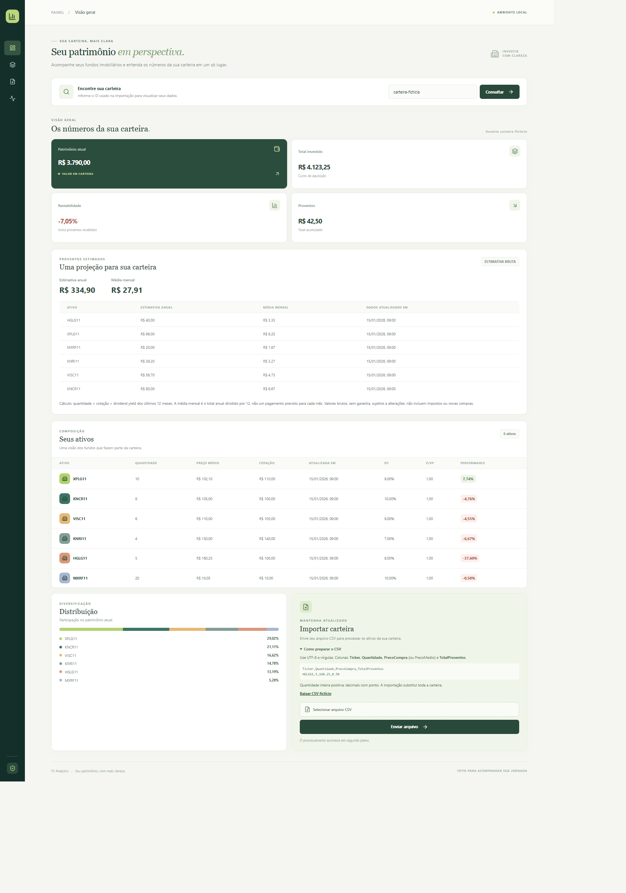
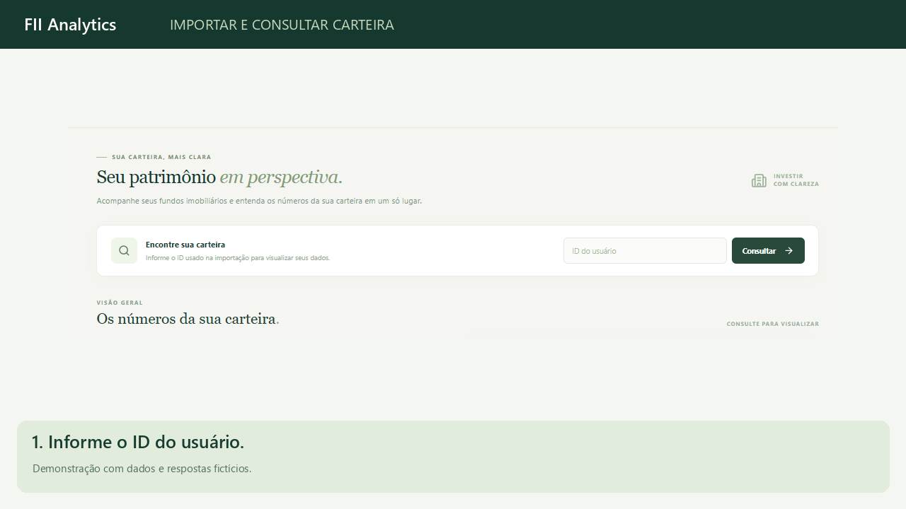
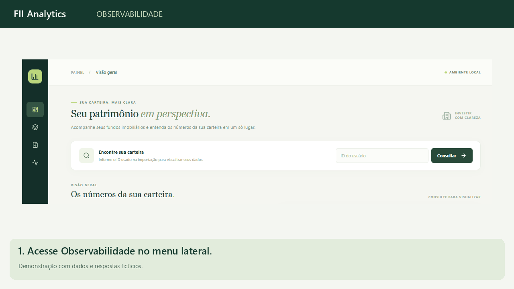
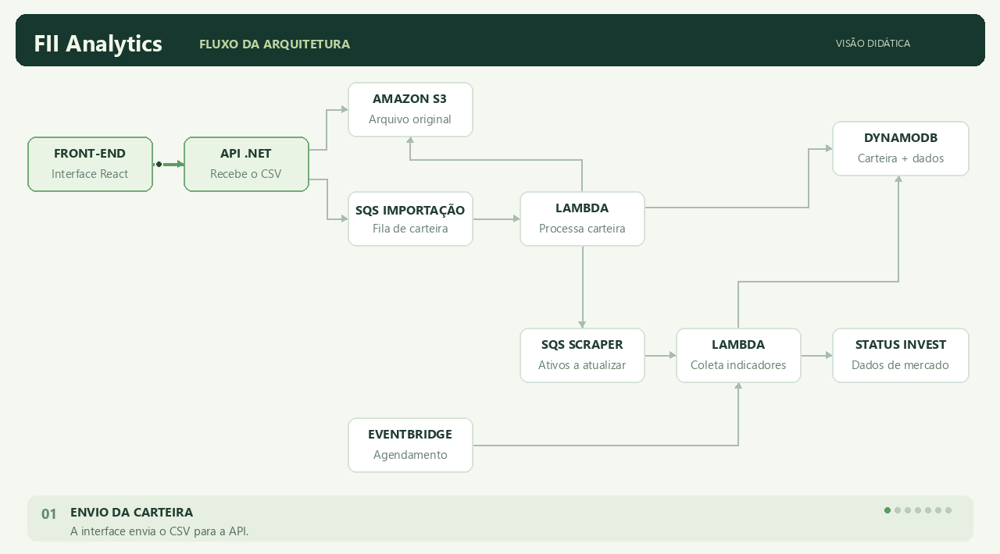
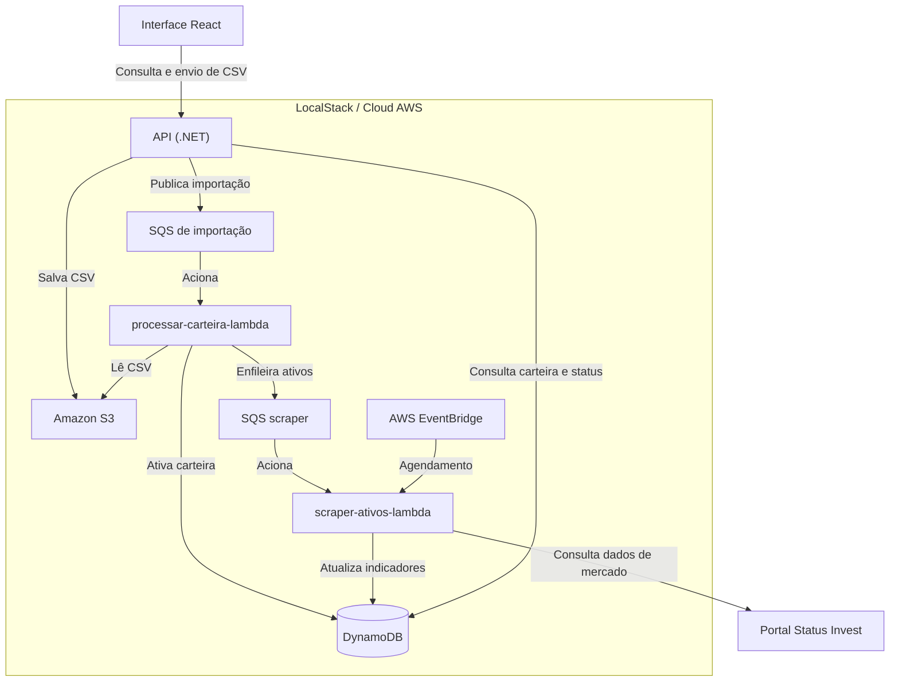

# FII Analytics Engine

Uma aplicação didática para importar e acompanhar carteiras de fundos imobiliários (FIIs). O projeto combina uma interface web, uma API .NET e processamento orientado a eventos para consolidar posições, consultar indicadores de mercado e estimar proventos.

> **Uso local e educacional.** A API não possui autenticação ou autorização e não deve ser exposta a redes ou usuários não confiáveis. As informações apresentadas não constituem recomendação de investimento.

[Interface](#interface) · [Execução local](#execução-local) · [Formato da carteira](#formato-da-carteira) · [Arquitetura](#arquitetura-e-fluxo-de-dados) · [API](#api) · [Observabilidade](#observabilidade-e-operação) · [Testes](#testes-e-build)

## Visão geral

- **Carteira:** importação de CSV, consolidação de ativos, preço médio, rentabilidade e distribuição.
- **Dados de mercado:** coleta de cotações e indicadores do Status Invest, com atualização por fila e agendamento.
- **Proventos:** estimativa bruta baseada no dividend yield histórico de 12 meses.
- **Observabilidade:** histórico de importações por usuário e contagens aproximadas das filas e DLQs.
- **Arquitetura:** API .NET, Lambdas Python e serviços AWS simulados localmente pelo LocalStack.

## Interface



*A captura contém carteira, valores e cotações fictícios. A aplicação consulta a API e não possui modo de demonstração.*

### Demonstrações

As animações usam dados e respostas simulados; nenhuma carteira é importada de fato.

<details>
<summary>Importar e consultar uma carteira</summary>

Informe o ID, prepare e envie o CSV, acompanhe o processamento e consulte a carteira com o mesmo ID.



</details>

<details>
<summary>Consultar a observabilidade</summary>

Informe o ID e selecione **Atualizar** para consultar as filas compartilhadas e o histórico de importações do usuário.



</details>

## Execução local

Os comandos abaixo usam PowerShell a partir da raiz do repositório.

### Pré-requisitos

| Ferramenta | Uso |
| --- | --- |
| Docker e Docker Compose | API, LocalStack e empacotamento das Lambdas |
| Node.js e npm | Interface: Node.js 22.22.2+ na linha 22, 24.15.0+ na linha 24, ou versão 26 ou posterior |
| SDK .NET 9 | Execução dos testes .NET localmente |
| Python 3.10 | Execução dos testes das Lambdas localmente |
| AWS CLI | Opcional, para inspecionar recursos do LocalStack a partir da máquina |

O Docker Desktop, ou o serviço Docker equivalente, deve estar em execução. O primeiro provisionamento precisa baixar imagens e instalar dependências das Lambdas.

### 1. Inicie a API e a infraestrutura

```powershell
docker compose -f .\src\FiiAnalyticsSolution\docker-compose.yml up -d
```

O Compose empacota as Lambdas, inicia o LocalStack e constrói a API. Acompanhe o provisionamento:

```powershell
docker logs -f fiianalytics_localstack
```

Aguarde a mensagem `PROVISIONAMENTO CONCLUÍDO COM SUCESSO`. A API estará disponível em `http://localhost:5000`; no ambiente de desenvolvimento, o Swagger está em `http://localhost:5000/swagger`.

### 2. Inicie a interface

Em outro terminal, a partir da raiz do repositório:

```powershell
cd .\src\FiiAnalyticsSolution\frontend
npm ci
npm run dev
```

Abra o endereço informado pelo Vite, normalmente `http://127.0.0.1:5173`. Informe um ID de usuário, selecione um CSV e envie a carteira. A interface acompanha o status da importação; após a conclusão, selecione **Consultar** para carregar a carteira. As cotações ainda podem estar em atualização.

O servidor de desenvolvimento encaminha `/api` para `http://127.0.0.1:5000`. Para outra porta, defina, por exemplo, `$env:API_PROXY_TARGET="http://127.0.0.1:5116"` antes de iniciar o Vite. O build estático precisa ser servido na mesma origem da API ou por um proxy que encaminhe `/api`.

## Formato da carteira

Utilize um arquivo CSV em UTF-8, separado por vírgulas. O exemplo [carteira-ficticia.csv](examples/carteira-ficticia.csv) também pode ser baixado pelo cartão de importação.

```csv
Ticker,Quantidade,PrecoCompra,TotalProventos
HGLG11,5,160.25,8.50
XPLG11,10,102.10,12.00
```

| Coluna | Formato |
| --- | --- |
| `Ticker` | Código do FII |
| `Quantidade` | Inteiro positivo |
| `PrecoCompra` | Preço de compra não negativo; `PrecoMedio` também é aceito |
| `TotalProventos` | Total de proventos da posição |

Use ponto nos valores decimais. Linhas do mesmo ticker são consolidadas com preço médio ponderado, calculado em decimal e armazenado com seis casas.

**Cada importação substitui a carteira inteira.** A versão anterior permanece ativa até a nova ser salva, e uma solicitação mais antiga não sobrescreve uma mais recente. Os snapshots históricos permanecem no DynamoDB e exigem uma política de limpeza caso o projeto cresça.

## Estimativa de proventos

Para cada ativo, o painel calcula:

```text
estimativa anual bruta = quantidade × cotação × dividend yield ÷ 100
média mensal = estimativa anual ÷ 12
```

O dividend yield utilizado é o indicador histórico de 12 meses informado pelo Status Invest. O cálculo usa decimais antes do arredondamento; os totais e os valores por ativo são arredondados separadamente.

A estimativa é ilustrativa: não prevê datas, não garante pagamentos e não considera impostos, reinvestimento ou alterações na carteira. Os proventos podem variar ou não ocorrer. Se o yield de algum ativo estiver ausente ou inválido, a estimativa total fica indisponível. A data dos dados aparece por ativo e pode estar ausente em registros antigos.

## Arquitetura e fluxo de dados



1. A interface envia o CSV à API, que salva o arquivo no S3 e publica uma mensagem na fila de importação.
2. A Lambda de processamento lê o CSV, consolida os ativos, enfileira solicitações para o scraper e ativa a nova versão da carteira no DynamoDB.
3. A Lambda de scraping consulta o Status Invest e atualiza os indicadores. O EventBridge também a aciona a cada 24 horas para uma varredura periódica.
4. A API consulta a carteira, os indicadores e o status de importação para atender à interface.

<details>
<summary>Ver diagrama estático da arquitetura</summary>



</details>

O script de provisionamento configura o ambiente LocalStack. Uma implantação na AWS requer configuração e infraestrutura apropriadas para aquele ambiente.

## API

O Swagger está disponível em `http://localhost:5000/swagger` quando a API é executada em desenvolvimento.

| Método | Endpoint | Uso |
| --- | --- | --- |
| `POST` | `/api/v1/carteira/importar` | Envia o arquivo no campo `file` e requer `X-Usuario-Id` |
| `GET` | `/api/v1/carteira/importacoes/{importacaoId}` | Consulta o status com o mesmo cabeçalho `X-Usuario-Id` |
| `GET` | `/api/v1/carteira/rentabilidade/{usuarioId}` | Consulta a carteira e seus indicadores |
| `GET` | `/api/v1/carteira/ativo/{ticker}` | Consulta um ativo usando `X-Usuario-Id` |
| `GET` | `/api/v1/observabilidade` | Consulta importações e filas usando `X-Usuario-Id` |

Para testar pelo Swagger, execute o `POST` com um ID e um CSV. A API retorna `202 Accepted`, `s3Key` e `importacaoId`; consulte o status com o mesmo ID. Os estados são `PENDENTE`, `PROCESSANDO`, `RETENTANDO`, `CONCLUIDO`, `FALHOU` e `SUPERADA`.

Os valores monetários serializados usam duas casas decimais; rentabilidade e performance usam quatro casas. Na consulta da carteira, `cotacaoAtualizadaEm` informa a última atualização dos dados de mercado e pode ser `null`.

## Observabilidade e operação

Na página **Observabilidade**, informe o ID e selecione **Atualizar**. São exibidas até 20 importações do usuário, ordenadas pela última atualização, e as contagens das filas de importação e scraping, incluindo suas DLQs.

As filas são compartilhadas por todos os usuários. As contagens são aproximadas, podem demorar a refletir alterações e não são atualizadas automaticamente. Em caso de indisponibilidade do DynamoDB ou SQS, a consulta apresenta erro. A busca percorre o histórico do usuário; para grandes volumes, seria necessário um índice apropriado. Esta visão local não substitui logs, alertas ou uma plataforma de métricas.

Para inspecionar os recursos provisionados:

```powershell
docker logs fiianalytics_localstack --tail 20
docker exec -it fiianalytics_localstack awslocal s3 ls
docker exec -it fiianalytics_localstack awslocal sqs list-queues
docker exec -it fiianalytics_localstack awslocal dynamodb list-tables
docker exec -it fiianalytics_localstack awslocal lambda list-functions
```

Com AWS CLI configurada para o ambiente local, também é possível consultar a tabela:

```powershell
aws --endpoint-url=http://localhost:4566 dynamodb scan --table-name FiiAnalyticsDb
```

Os controles e estados são armazenados sob `USER#{id}`; os ativos ficam no snapshot da importação ativa.

### Falhas e limitações

- As filas tentam novamente mensagens malsucedidas e, após cinco recebimentos, encaminham-nas para `fii-importacao-dlq` ou `scraper-dlq`. Investigue antes de reenviar: o processamento pode ocorrer mais de uma vez.
- As políticas de DLQ são configuradas no provisionamento de novos ambientes. Em instalações existentes, atualize as filas sem apagar os dados.
- Se o scraping falhar ou retornar indicadores inválidos, os últimos metadados válidos são preservados. Sem cotação válida, a API retorna HTTP `503` nas consultas de carteira e ativo.
- Se o upload ao S3 for bem-sucedido e o envio à fila falhar, a API retorna erro, mas o arquivo pode permanecer no bucket e precisar de limpeza.
- `CONCLUIDO` indica que a carteira foi salva, não que todas as cotações foram atualizadas. Falhas tratadas na última tentativa são marcadas como `FALHOU`.
- Interrupções abruptas, timeout ou indisponibilidade do DynamoDB podem deixar um status em processamento. Verifique logs e DLQ e reimporte se necessário. A interface avisa quando o status fica sem atualização por mais de sete minutos.
- Mensagens de importação anteriores à inclusão do identificador não são compatíveis com o processador atual. Processe ou remova-as com cuidado antes da atualização; para mensagens já na DLQ, reimporte os arquivos.
- A varredura periódica pode encontrar tickers de snapshots históricos e gerar atualizações desnecessárias, sem alterar a carteira ativa.

## Testes e build

O GitHub Actions executa testes .NET, testes Python com transações no LocalStack e build e testes do front-end.

### .NET

Na raiz do repositório, para executar os testes que não dependem de infraestrutura externa:

```powershell
dotnet test .\src\FiiAnalyticsSolution\src\FiiAnalyticsSolution.sln --filter "Category!=Integration"
```

Para a suíte completa, incluindo os testes de integração com Testcontainers, inicie o Docker e execute:

```powershell
dotnet test .\src\FiiAnalyticsSolution\src\FiiAnalyticsSolution.sln
```

Na primeira execução, o download das imagens pode aumentar o tempo dos testes. Em caso de falha, verifique o serviço e as permissões do Docker, a disponibilidade do socket e os recursos de memória; no Linux/WSL, verifique também a permissão de acesso ao socket.

### Lambdas Python

Na raiz do repositório, com Python 3.10:

```powershell
py -3.10 -m venv .venv
.\.venv\Scripts\Activate.ps1
python -m pip install -r .\src\FiiAnalyticsSolution\serverless\lambdas\processar_carteira\requirements.txt -r .\src\FiiAnalyticsSolution\serverless\lambdas\scraper_ativos\requirements.txt
python -m unittest discover -s .\src\FiiAnalyticsSolution\serverless\tests -v
```

Para incluir o teste de transações Python, inicie um LocalStack com DynamoDB e defina `$env:FII_TEST_DYNAMODB_ENDPOINT` com seu endereço antes do último comando. O teste cria e remove uma tabela própria.

### Front-end

Na pasta `src/FiiAnalyticsSolution/frontend`, após `npm ci`:

```powershell
npm run build
npm test
```

## Tecnologias e estrutura

| Camada | Tecnologias |
| --- | --- |
| Interface | React, TypeScript, Vite |
| API e aplicação | C# e .NET |
| Processamento e scraping | Python, pandas, Requests, BeautifulSoup |
| Serviços e infraestrutura local | S3, SQS, Lambda, DynamoDB, EventBridge, LocalStack e Docker Compose |
| Testes | Testcontainers, xUnit, unittest e Vitest |

```text
examples/                               Exemplos, capturas e animações
src/FiiAnalyticsSolution/
├── frontend/                           Interface web
├── localstack-init/                    Provisionamento dos recursos locais
├── serverless/                         Lambdas e testes Python
├── src/
│   ├── FiiAnalytics.API/               API HTTP
│   ├── FiiAnalytics.Application/       Casos de uso, consultas e DTOs
│   ├── FiiAnalytics.Domain/            Domínio e contratos
│   ├── FiiAnalytics.Infrastructure/    Repositórios e integrações AWS
│   └── tests/                          Testes .NET
└── docker-compose.yml                  Serviços locais
```

Mantenha os scripts e arquivos de configuração em UTF-8 e, para execução em contêineres Linux, com finais de linha LF.

## Contribuições

Sugestões, issues e pull requests são bem-vindos.
